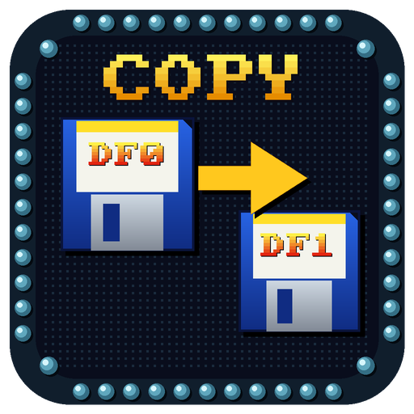
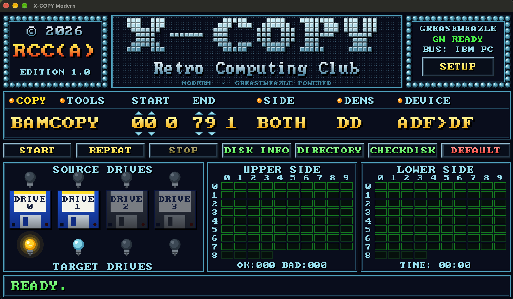

<p align="center">
  
</p>

<h1 align="center">X-COPY Modern</h1>

<p align="center">
  <b>Retro Computing Club · RCC(A) Edition 1.0</b><br>
  Copier, formater et écrire des disquettes <b>Amiga</b> avec un <b>Greaseweazle</b>,<br>
  dans une interface rétro inspirée de X-COPY.
</p>

<p align="center">
  
  
  
  
  
  <a href="https://github.com/sohappy/x-copy-rcc/actions/workflows/ci.yml"></a>
</p>

<p align="center">
  
</p>

---

## Sommaire

- [Fonctions](#fonctions)
- [Télécharger](#télécharger)
- [Installation](#installation)
- [Premiers pas](#premiers-pas)
- [Utilisation](#utilisation)
- [Dépannage](#dépannage)
- [Compiler depuis les sources](#compiler-depuis-les-sources)
- [Organisation du code](#organisation-du-code)
- [Crédits](#crédits)
- [Licence](#licence)

## Fonctions

### Section COPY

| Mode | Effet |
|---|---|
| `DOSCOPY` | Copie secteur AmigaDOS (ADF), avec écriture vérifiée. |
| `DOSCOPY+` | Comme DOSCOPY, avec le profil récupération (5 tours, 8 relectures, 2 repositionnements de la tête) pour les disques abîmés. |
| `BAMCOPY` | Lit d'abord le cylindre 40 (bloc racine et bitmap), puis **seulement les cylindres qui contiennent des fichiers**. Beaucoup plus rapide sur un disque peu rempli. Le disque cible est écrit en entier, les pistes libres vierges. Si le bitmap est invalide, il lit tout le disque. |
| `NIBBLE` | Copie au niveau du flux magnétique (SCP) : garde les protections anti-copie. |

**DEVICE** choisit le sens de la copie :

| DEVICE | Effet |
|---|---|
| `DF>DF` | Disque vers disque. Si la source et la cible sont le même lecteur, X-COPY demande d'échanger les disquettes. |
| `DF>ADF` | Disque vers fichier image. Le nom du volume est proposé comme nom de fichier (`Workbench Games.adf`). |
| `ADF>DF` | Fichier image (`.adf`, `.scp`, `.ipf`, `.hfe`…) vers un ou plusieurs disques. DD ou HD est reconnu à la taille du fichier. |

### Section TOOLS

| Mode | Effet |
|---|---|
| `FORMAT` | Disque AmigaDOS vierge (OFS/FFS, DD/HD, nom de volume), écrit et vérifié. Avec DEVICE = `ADF`, enregistre une image vierge. |
| `QFORMAT` | Formatage rapide : toutes les pistes sont écrites, mais sans relecture de vérification. |
| `TRACK0` | Efface puis réécrit **uniquement la piste 0** (boot block vierge), avec 8 relectures de vérification. Le reste du disque n'est pas touché ; le disque ne démarre plus mais ses fichiers restent lisibles. |
| `ERASE` | Efface la plage de pistes choisie. |
| `SPEEDCHK` | Mesure la vitesse du lecteur source (tr/min et écart à 300). |
| `CLEAN` | Nettoyage des têtes avec une disquette de nettoyage. |

### Boutons

| Bouton | Touche | Effet |
|---|---|---|
| **START** | Entrée | Lance l'opération. Une confirmation est demandée avant d'écraser un disque. |
| **REPEAT** | F2 | Réécrit la dernière image sur de nouvelles disquettes, sans relire la source. Pratique pour une série de copies. |
| **STOP** | Échap | Interrompt proprement ; le lecteur est libéré. |
| **DISK INFO** | | Modèle, firmware, port et USB du Greaseweazle. |
| **DIRECTORY** | | Volume, système de fichiers, état du boot block et liste des fichiers du disque source ou d'un ADF. |
| **CHECKDISK** | | Lecture rapide de toute la disquette et carte de santé des pistes. |
| **DEFAULT** | | Remet les options de copie par défaut. |

### Et aussi

- **Contrôle du boot block** après chaque lecture en mode secteur : *vierge*, *standard* (Install du
  Workbench), *code inconnu* (chargeur de jeu, intro de démo… ou virus) ou *suspect* (texte typique de
  virus : « VIRUS », « LAMER », « BANDIT »…). Pour un boot block inconnu ou suspect, X-COPY propose
  **REPLACE** (boot block vierge dans l'image) ou **KEEP**. Ce n'est pas un antivirus : il n'y a pas de
  base de signatures.
- **Plusieurs lecteurs cibles** à la fois (lampes du bas).
- **Copie partielle** par plage de cylindres (START / END) et par face (SIDE).
- **Grilles de pistes en direct**, face haute et face basse ; le survol d'une case détaille ses secteurs.
- **Explication en clair des erreurs** de `gw` (No Index, échec de vérification…).
- **Journal complet** des commandes `gw` : cliquez sur la ligne d'état en bas.
- **Mélodies rétro** de fin, d'abandon et d'erreur, désactivables dans SETUP.
- Réglages mémorisés entre deux sessions.

## Télécharger

Les exécutables prêts à l'emploi sont sur la page
**[Releases](https://github.com/sohappy/x-copy-rcc/releases)** :

| Système | Fichier | Lancement |
|---|---|---|
| Windows 10/11 (x64) | `X-COPY-Modern-…-windows-x86_64.zip` | Dézippez et lancez `X-COPY-Modern.exe`. |
| macOS 11+ (Apple Silicon et Intel) | `X-COPY-Modern-…-macos-universal.zip` | Dézippez et glissez **X-COPY Modern.app** dans Applications. L'application n'est pas signée : au premier lancement, **clic droit → Ouvrir**. |
| Linux x86_64 | `X-COPY-Modern-…-linux-x86_64.tar.gz` | Décompressez puis lancez `./install.sh` (installation pour l'utilisateur, avec entrée de menu et icône). |

Si macOS refuse toujours d'ouvrir l'application (« endommagée ») :

```bash
xattr -dr com.apple.quarantine "/Applications/X-COPY Modern.app"
```

## Installation

X-COPY Modern pilote le Greaseweazle à travers les **outils officiels `gw`** de Keir Fraser, qu'il faut
installer d'abord.

### macOS

```bash
pip3 install greaseweazle
```

pip installe souvent `gw` dans un dossier qui n'est pas dans le PATH, par exemple
`~/Library/Python/3.9/bin/gw`. X-COPY le trouve tout seul, mais pour l'utiliser aussi dans le Terminal :

```bash
echo 'export PATH="$HOME/Library/Python/3.9/bin:$PATH"' >> ~/.zprofile
source ~/.zprofile
gw info
```

(Remplacez `3.9` par votre version de Python.) Le Greaseweazle apparaît sous la forme `/dev/cu.usbmodem…`.

Le message `NotOpenSSLWarning` du Python d'Apple est sans conséquence pour les disquettes.
Pour le faire disparaître : `pip3 install "urllib3<2"`.

### Windows

Téléchargez l'archive officielle des outils Greaseweazle et dézippez-la **à côté de
`xcopy-modern.exe`**, ou dans un dossier `greaseweazle-…` du même répertoire.

### Linux

```bash
pip install --user greaseweazle
sudo usermod -aG dialout $USER   # accès USB, puis reconnectez-vous
```

### Si `gw` n'est pas trouvé

Cliquez sur **SETUP** (en haut à droite) et collez le chemin complet de `gw` dans *GW PROGRAM*,
ou cliquez sur **DETECT**. Vous pouvez aussi lancer le programme avec la variable `XCOPY_GW` :

```bash
XCOPY_GW=$(which gw) ./xcopy-modern
```

## Premiers pas

1. Branchez le Greaseweazle **et l'alimentation du lecteur** (connecteur 4 broches : le Greaseweazle
   n'alimente pas le lecteur).
2. Lancez X-COPY Modern. En haut à droite, la ligne GREASEWEAZLE doit afficher **GW READY**.
3. Cliquez sur **DISK INFO**. La ligne passe à **DEVICE OK** et affiche le modèle.
4. Vérifiez le câblage dans **SETUP → BUS** :
   - **IBM PC** (par défaut) : lecteurs PC sur nappe torsadée. DF0 = lecteur A (après la torsade),
     DF1 = lecteur B.
   - **SHUGART** : lecteurs Amiga d'origine ou nappe droite. DF0 à DF3 = unités 0 à 3.
5. Insérez une disquette Amiga et cliquez sur **CHECKDISK** : c'est une lecture seule, sans risque.

## Utilisation

**Copier une disquette avec un seul lecteur**
COPY → `DOSCOPY` (ou `BAMCOPY`), DEVICE `DF>DF`, lampe source DF0 et lampe cible DF0, puis **START**.
X-COPY lit la source, puis demande d'insérer la disquette cible. **REPEAT** refait une copie de plus.

**Enregistrer une disquette en ADF**
DEVICE `DF>ADF`, puis **START**. Le nom du volume est proposé comme nom de fichier.

**Écrire un ADF sur une disquette**
DEVICE `ADF>DF`, choisissez le ou les lecteurs cibles, **START**, puis choisissez le fichier.

**Formater**
TOOLS → `FORMAT`, cliquez sur NAME pour le nom du volume, choisissez FS (OFS pour Kickstart 1.x,
FFS pour 2.0 et plus) et DENS, puis **START**.

### Lire les grilles de pistes

| Case | Signification |
|---|---|
| `O` vert | Piste lue, ou écrite et vérifiée. |
| `R` jaune | Récupérée après relectures : surface fatiguée. |
| `1`…`9` rouge | Piste illisible : nombre de secteurs manquants (`X` = plus de 9). |
| `?` orange | Relecture en cours. |
| `U` bleu | Piste vide (non formatée). |
| `F` cyan | Flux brut capturé (NIBBLE). |
| Blanc clignotant | Piste en cours. |
| Case sombre | Piste hors de l'opération (par exemple, non lue en BAMCOPY). |

Face **haute** = tête 1, face **basse** = tête 0 (convention Amiga).

### Réglages

- Flèches de START / END : clic = 1 cylindre, clic droit = 10, ou molette.
- Options avec un point orange : un clic les fait défiler. Un clic droit sur le mode le fait défiler dans l'autre sens.
- Lampes du haut = lecteur source, lampes du bas = lecteurs cibles (plusieurs possibles).

## Dépannage

| Message ou symptôme | Cause probable et solution |
|---|---|
| `GW NOT FOUND` | Outils `gw` absents ou hors du PATH : voir [Si `gw` n'est pas trouvé](#si-gw-nest-pas-trouvé). |
| `GetFluxStatus: No Index` | Le lecteur ne voit pas tourner la disquette. Vérifiez l'alimentation du lecteur, que la disquette est bien enfoncée, le bus (IBM ou Shugart) et le lecteur choisi. Testez chaque position avec `gw rpm --drive A`, `B`, `0`, `1`. |
| `Failed to verify Track 0.x` sur beaucoup de disquettes | Piste 0 usée (la plus sollicitée sur Amiga), disquette **HD** utilisée en DD (masquez le trou de densité avec un adhésif opaque), ancien formatage (essayez `TRACK0` ou `ERASE` puis FORMAT), ou tête encrassée (`CLEAN`). |
| Cases rouges après FORMAT + CHECKDISK | Surface abîmée : disquette à écarter. |
| La LED du lecteur reste allumée | Nappe montée à l'envers. |

**Savoir si une disquette est HS** : FORMAT (pas QFORMAT), puis CHECKDISK. Tout en `O` vert : bonne.
Quelques `R` : fatiguée. Des cases rouges : HS sur ces pistes. Testez d'abord une disquette connue
comme bonne, pour mettre le lecteur hors de cause.

## Compiler depuis les sources

Il faut **Rust 1.95 ou plus récent**, installé avec [rustup](https://rustup.rs). Un Rust déjà
installé se met à jour avec `rustup update`.

### Windows

1. Installez les **Visual Studio Build Tools** avec la charge de travail
   « Développement Desktop en C++ » (l'installeur de rustup le propose).
2. Installez Rust : téléchargez et lancez `rustup-init.exe` depuis [rustup.rs](https://rustup.rs).
3. Dans PowerShell :

```powershell
git clone https://github.com/sohappy/x-copy-rcc.git
cd x-copy-rcc
cargo build --release -p xcopy-modern
.\target\release\xcopy-modern.exe
```

L'icône est intégrée à l'exécutable par `build.rs`.

### macOS

```bash
xcode-select --install                                           # outils Apple (une fois)
curl --proto '=https' --tlsv1.2 -sSf https://sh.rustup.rs | sh   # Rust (une fois)
git clone https://github.com/sohappy/x-copy-rcc.git
cd x-copy-rcc
cargo build --release -p xcopy-modern
./target/release/xcopy-modern
```

Pour obtenir une application **X-COPY Modern.app** avec son icône (dans `dist/`) :

```bash
bash packaging/package.sh macos
```

Version universelle (Apple Silicon + Intel) :

```bash
rustup target add aarch64-apple-darwin x86_64-apple-darwin
cargo build --release -p xcopy-modern --target aarch64-apple-darwin
cargo build --release -p xcopy-modern --target x86_64-apple-darwin
mkdir -p target/universal
lipo -create -output target/universal/xcopy-modern \
  target/aarch64-apple-darwin/release/xcopy-modern target/x86_64-apple-darwin/release/xcopy-modern
bash packaging/package.sh macos-universal
```

### Linux

Bibliothèques système nécessaires à l'interface graphique (Debian / Ubuntu) :

```bash
sudo apt install build-essential pkg-config libxkbcommon-dev libgl1-mesa-dev libwayland-dev \
  libxcb-render0-dev libxcb-shape0-dev libxcb-xfixes0-dev
curl --proto '=https' --tlsv1.2 -sSf https://sh.rustup.rs | sh
git clone https://github.com/sohappy/x-copy-rcc.git
cd x-copy-rcc
cargo build --release -p xcopy-modern
./target/release/xcopy-modern
```

Fedora : `sudo dnf install gcc pkgconf libxkbcommon-devel mesa-libGL-devel wayland-devel libxcb-devel`.

Pour installer le programme avec une entrée de menu et son icône :

```bash
bash packaging/package.sh linux-x86_64
tar xzf dist/X-COPY-Modern-dev-linux-x86_64.tar.gz
./X-COPY-Modern-dev-linux-x86_64/install.sh
```

### Tests

```bash
cargo test --workspace
```

### Compilation automatique (GitHub Actions)

* **`ci.yml`** : à chaque push, compile et teste sur Linux, Windows et macOS.
* **`release.yml`** : à chaque tag `v…`, compile les trois versions (Windows `.zip`, macOS `.app`
  universelle, Linux `.tar.gz`) et publie une release GitHub :

```bash
git tag v1.0.0
git push origin v1.0.0
```

Depuis l'onglet **Actions → Release → Run workflow**, les trois versions sont compilées et
téléchargeables comme artefacts, sans publier de release.

### Essai sans matériel

`tools/fake-gw.py` simule `gw` : un disque Amiga avec 3 pistes abîmées, une écriture avec une
relecture de vérification, `info`, `rpm`…

```bash
XCOPY_GW=$PWD/tools/fake-gw.py ./target/release/xcopy-modern

# Le « disque » dans le lecteur est cet ADF (pour tester BAMCOPY, DIRECTORY, le boot block…)
FAKE_ADF=mon_disque.adf XCOPY_GW=$PWD/tools/fake-gw.py ./target/release/xcopy-modern

# Simule un échec de vérification à l'écriture
FAKE_VERIFY_FAIL=1 XCOPY_GW=$PWD/tools/fake-gw.py ./target/release/xcopy-modern
```

## Organisation du code

```
crates/
├── hgf-core/        Moteur Greaseweazle (sans interface, testé)
│                    commandes gw, exécution avec annulation, analyse de la sortie,
│                    carte des pistes, images AmigaDOS vierges, explorateur ADF, aides
└── xcopy/src/
    ├── main.rs      Fenêtre (eframe/egui), icône
    ├── app.rs       Écran X-COPY : disposition, clics, requêteurs, construction des opérations
    ├── engine.rs    File d'étapes (gw, confirmation, échange de disque, contrôles) sans bloquer l'interface
    ├── amiga.rs     Analyse AmigaDOS : bitmap (BAMCOPY), nom du volume, boot block
    ├── gfx.rs       Écran virtuel 1280 × 720 mis à l'échelle, panneaux rivetés, lampes, disquettes, logo
    ├── font.rs      Police bitmap 8 × 8 rendue en texture, avec dégradé et ombre
    ├── sound.rs     Mélodies carrées synthétisées en WAV, jouées par le lecteur du système
    └── settings.rs  Options mémorisées
packaging/           Icônes (PNG 16 à 512 px, .ico, .icns), package.sh, bundle macOS, installation Linux
tools/fake-gw.py     Simulateur de gw pour les tests
.github/workflows/   ci.yml (tests 3 systèmes), release.yml (exécutables et release)
```

## Crédits

- **[Greaseweazle](https://github.com/keirf/greaseweazle)** et ses outils `gw` : Keir Fraser.
- **hgf-core** : moteur de HappyGreaseFloppy, repris dans `crates/hgf-core`.
- **[egui / eframe](https://github.com/emilk/egui)** : interface graphique.
- **[font8x8](https://crates.io/crates/font8x8)** : glyphes bitmap 8 × 8 (domaine public).
- **[rfd](https://crates.io/crates/rfd)** : sélecteurs de fichiers natifs.

L'interface rend hommage à **X-COPY Professional**, le copieur Amiga des années 90. Le logo, les
graphismes et les sons sont des créations originales. Le logo d'origine, les crédits de ses
auteurs, la mascotte et le logo Amiga ne sont pas reproduits. X-COPY et Amiga sont des marques de
leurs propriétaires respectifs. Ce projet n'est affilié ni à eux ni au projet Greaseweazle.

## Licence

Copyright © 2026 Retro Computing Club (RCC).

X-COPY Modern est un logiciel libre : vous pouvez le redistribuer et le modifier selon les termes de
la **GNU General Public License version 3**, ou (à votre choix) de toute version ultérieure, telle que
publiée par la Free Software Foundation (`GPL-3.0-or-later`).

Ce programme est distribué dans l'espoir qu'il sera utile, mais **sans aucune garantie** ; pas même
la garantie implicite de qualité marchande ou d'adéquation à un usage particulier. Le texte complet
est dans le fichier [`LICENSE`](LICENSE).

Les bibliothèques utilisées restent sous leurs propres licences, toutes compatibles avec la GPL-3.0
(MIT, Apache-2.0, Zlib, BSD, ISC) ; les glyphes `font8x8` sont dans le domaine public. Les outils
Greaseweazle (`gw`) sont un programme séparé, appelé par X-COPY Modern et non inclus.

> ⚠️ L'écriture, le formatage et l'effacement **détruisent** le contenu des disquettes cibles.
> Faites une image ADF de vos disquettes précieuses avant toute manipulation.
